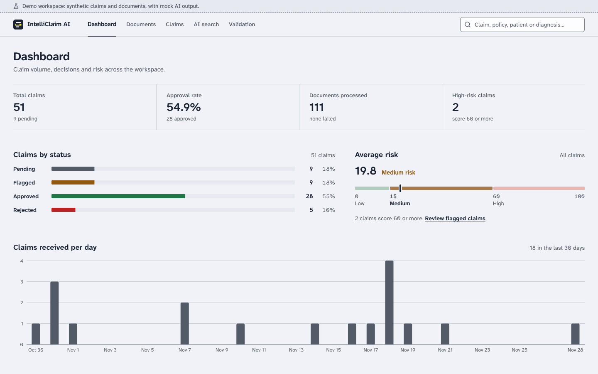
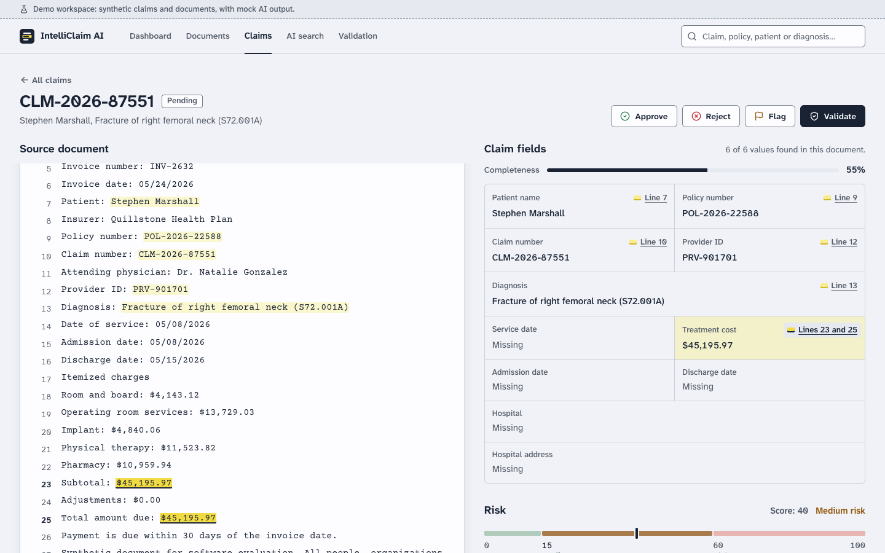
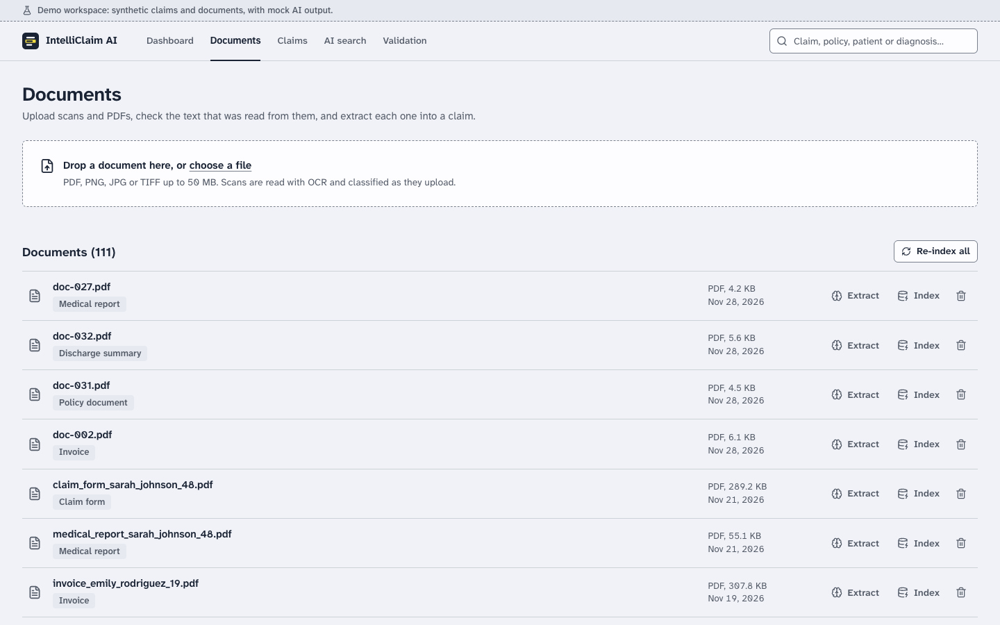
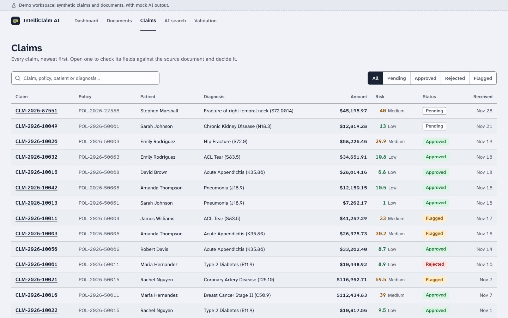
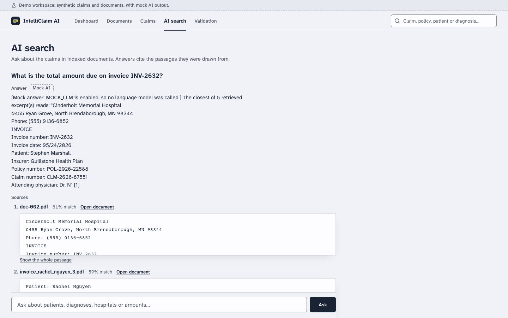
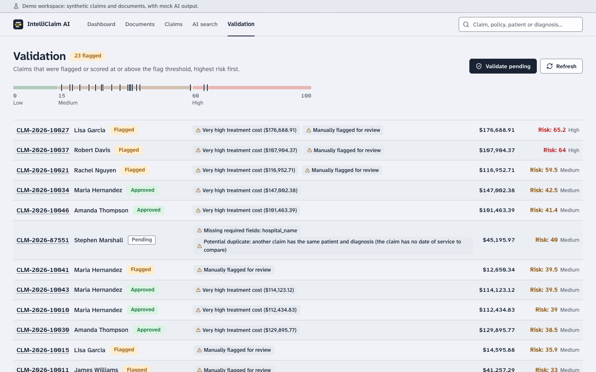
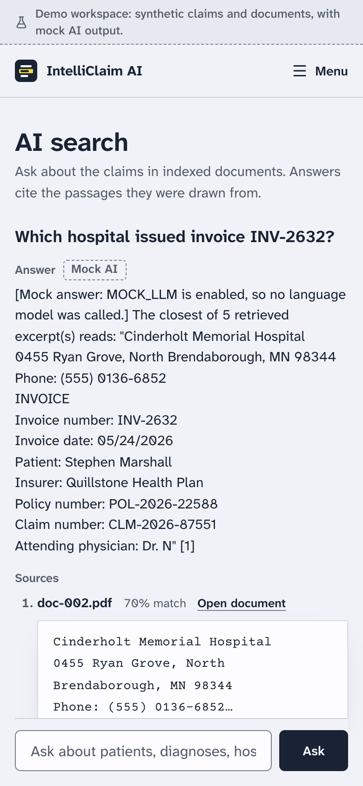
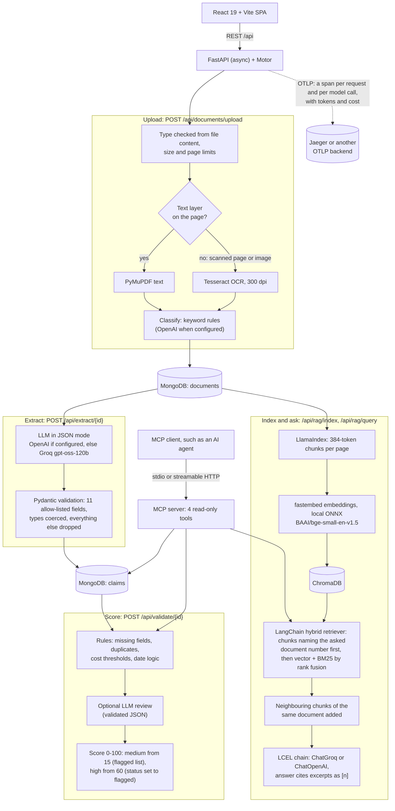

<p align="center"></p>

# IntelliClaim AI

[](https://github.com/shreyashyadav1/intelliclaim-ai/actions/workflows/backend-ci.yml)
[](https://github.com/shreyashyadav1/intelliclaim-ai/actions/workflows/frontend-ci.yml)
[](LICENSE)

Document intake and risk triage for health insurance claims: OCR, LLM field extraction with validation, cited
search over the documents, and a risk score whose cut-off was chosen on a labelled evaluation set. An MCP server gives
AI agents read-only access to the same claims and search, and OpenTelemetry traces record what every model call cost.

## Problem and what the system does

Claims arrive as stacks of PDFs and scans: invoices, discharge summaries, medical reports, policy documents. Someone
has to read each one, retype the claim fields, find the related paperwork and decide which claims need a closer look.
IntelliClaim AI is a full-stack prototype of that intake step. It reads uploaded PDFs and images (OCR for scanned
pages), classifies each document, extracts eleven claim fields with an LLM and validates them before anything is
saved, answers natural-language questions over the indexed documents with citations to the source pages, and scores
every claim with deterministic rules plus an optional LLM review so that risky claims land on a review list. The review
screen finds each extracted value in the document's text and points to the line it appears on, or says plainly that
the document does not contain it, so a reviewer checks the claim against its source instead of retyping it. Every number on the dashboard comes from MongoDB, and AI output is
either real or explicitly labelled as mock.

## Live demo status

The hosted backend is offline for now and will be restored; until then the frontend at
[intelliclaim-ai.vercel.app](https://intelliclaim-ai.vercel.app) says that the demo server is offline. Everything
runs locally, and demo mode (`MOCK_LLM=true`) needs no API key. See [Local setup](#local-setup).

## Screenshots

Screenshots use synthetic demo data with mock AI output: `MOCK_LLM=true`, the claims from `seed_data.py`, and four
fictional documents from the evaluation dataset uploaded through the normal pipeline. The mock extractor is simple
pattern matching, so the claim detail shows fewer fields than a model fills (see [Evaluation](#evaluation) for
extraction with Groq).

| Dashboard | Claim detail |
|:---:|:---:|
|  |  |
| **Documents** | **Claims** |
|  |  |
| **AI search** | **Validation** |
|  |  |

<p align="center"></p>

## Architecture



- **Upload** stores the file, reads every PDF page's text layer with PyMuPDF and sends pages without one, and every
  image (each TIFF frame counts as a page), to Tesseract. A document whose text cannot be extracted is saved with
  `processing_status: "failed"` and the reason, so failures are visible rather than silently empty.
- **Extraction** sends at most `EXTRACTION_MAX_INPUT_CHARS` characters to the model, then updates the claim the
  document is linked to, links it to an existing claim with the same claim number, or creates a new claim. The API
  has no other way to create one.
- **Search** indexes through LlamaIndex (`IngestionPipeline` into a Chroma collection) and answers through LangChain
  (an LCEL chain over a hybrid retriever). Chunks that contain every document number the question names (such as
  `INV-3023`) go first; the rest are vector and BM25 results fused by rank. Each ranked chunk brings the chunk before
  and after it from the same document, so a date printed on page 1 still reaches the model when page 2 is what
  matched. One fastembed model, loaded once per process, serves both frameworks, and each answer returns the
  documents and page numbers it cited.
- **Agents** connect through the MCP server (`backend/mcp_server.py`), which offers four read-only tools over the
  same services: `search_documents`, `get_claim`, `list_flagged_claims` and `validate_claim`, which scores a claim
  without saving the result. Tool reference and client setup: [docs/MCP.md](docs/MCP.md).
- **Tracing** gives every request an OpenTelemetry span and every model call a child span carrying the model, token
  counts and estimated cost, and adds the spend to the document or claim it was for (`ai_usage`). Responses carry an
  `X-Trace-Id` header. Spans leave the process only when `TRACING_ENABLED=true`. Details:
  [docs/TRACING.md](docs/TRACING.md).
- **Risk** combines rule findings (25 / 15 / 5 points for high / medium / low severity) with the LLM review's score
  (`ai_risk_score x 0.4 x mean flag confidence`), capped at 100. Medium risk and the flagged-claims list start at
  `RISK_FLAG_THRESHOLD` (default 15); high risk starts at 60.

## Key design decisions and trade-offs

**Hybrid retrieval by default, exact document numbers first.** Embeddings do not tell invoices apart by number: on
the evaluation set, questions that name a document number ("total amount due on invoice INV-2632?") find their source
in the top five 24% of the time with vector search and 79% with BM25 fused in. Over all 216 questions, hybrid
retrieval raises recall@5 from 0.653 to 0.907 and MRR from 0.553 to 0.756. The 0.5/0.5 fusion weights were picked by
a rule written before the comparison: the best answer-in-top-5 among configurations that keep every question style's
MRR at or above vector search. BM25-heavier weights scored higher overall but ranked paraphrased questions below
vector search, so they lost. The 20 questions still missed all named a document that BM25 ranked first; rank fusion
keeps only ranks, so that margin was lost. Chunks that contain every document number in the question now go first,
which brought recall@5 to 1.000 on this dataset, its best case (see [Evaluation](#evaluation)). Cost: the BM25 index
is rebuilt in memory from all stored chunks after each write, fine for a demo corpus but not for millions of chunks.

**Validated, allow-listed model output.** The LLM's JSON never reaches the database directly. Extraction output is
parsed into a Pydantic model with exactly the eleven claim fields: unknown keys such as `_id` or `status` are dropped,
dates and amounts are coerced (an unparseable value becomes `null`), text is length-limited, and a reply with no
recognisable field is rejected with HTTP 502. The risk review is validated the same way (flags filtered, scores
clamped to 0-100). Prompts mark document text as data, not instructions. `completeness` reports how many of the
eleven fields were found (it is not a model confidence). The trade-off: a value the model gets wrong is still stored.
The claim screen shows the line each value was found on, so a reviewer can catch it before approving, but fields
cannot be corrected in the UI yet.

**No silent mock data.** Without a provider key, AI endpoints return 503. A provider failure returns 502 and leaves
the claim untouched. Mock output exists only with `MOCK_LLM=true` and carries `"source": "mock"` (`ai_review.source`
for the risk review); the UI labels mock extraction and search results "Mock AI". The dashboard shows only what
MongoDB returns, with loading, empty and error states.

**OCR as a fallback, not the default.** PDFs produced by software carry a text layer, which PyMuPDF reads exactly
(character error rate 0 on the evaluation set); only pages without one, and images, go through Tesseract. The cost is
latency inside the request: OCR took about 1.8 s per scanned page in the evaluation.

**Calibrated flagging.** The flagged-claims list used to start at a score of 30, which no single rule finding reaches:
it caught 9% of the labelled anomalies. The cut-off is now a setting whose default, 15, is the threshold with the
highest F1 on the risk evaluation (precision 0.795, recall 0.767), chosen by a rule fixed before the sweep. The UI
takes its risk bands from the API's `flag_threshold`, so its colours follow the configured threshold. The LLM
review ranks claims better (PR-AUC 0.805 to 0.883) but also flags more clean claims, and the threshold has to work
without a provider too, so it stays at 15.

**Agents get read-only tools.** The MCP server calls the API's own services rather than a second implementation, and
every tool is marked read-only. `validate_claim` returns a score without storing it, so an agent can look up, search
and triage claims but cannot approve, reject or overwrite one; storing a result still goes through
`POST /api/validate/{claim_id}`.

**AI cost from the provider's own token counts.** Each model call's span records the tokens the provider reported and
a cost from configurable prices (Groq's list price for gpt-oss-120b by default). OpenAI has no default price, so its
calls are counted as unpriced instead of being added as zero, and a partial total is never shown as a complete one.
Spend is added per stage to the document or claim with MongoDB `$inc`, so concurrent runs add up correctly, and it is
recorded even when the reply is unusable, because the provider still billed for it.

**Cheap to run, easy to switch providers.** Embeddings run locally (fastembed ONNX, no GPU or PyTorch), so changing the
chat provider never requires re-indexing. With `OPENAI_API_KEY` set, OpenAI is tried first and Groq is the fallback;
otherwise Groq's `openai/gpt-oss-120b` is used. The project moved off Llama 3.3 70B after Groq retired it for free and
developer tiers on 2026-08-16. gpt-oss reasons before answering, at `GROQ_REASONING_EFFORT` (low by default) for
extraction, the risk review and search answers alike, and the reasoning counts toward `max_tokens`, so the limits leave
room for it.

**Abuse limits without accounts.** Per-client rate limits (slowapi) cover uploads, writes, AI calls, search and bulk
operations, with `TRUSTED_PROXY_COUNT` deciding how much of `X-Forwarded-For` to trust. When `ADMIN_API_KEY` is set,
deletes, `POST /api/rag/index-all` and the Groq connectivity check require it in `X-Admin-Key`. Uploads are checked by
their bytes (not the client's Content-Type), and size limits are enforced while streaming.

## Evaluation

The backend ships an evaluation harness (`backend/evals/`) that runs the application's own code against a synthetic,
labelled dataset: 60 fictional documents (24 invoices, 12 outpatient medical reports, 12 two-page discharge summaries,
12 policy summaries), 216 answerable questions plus 12 unanswerable ones, and 206 incoming claims (86 with injected
anomalies) against a 60-claim history. The generator is committed and seeded; the PDFs (29 MB with scanned variants)
are rendered on demand. Full method, per-style tables and caveats: [backend/evals/README.md](backend/evals/README.md).

Headline results (each comes from a dated run in the table below):

| Suite | What is measured | Result |
|---|---|---|
| Retrieval | Source document in the top 5, 216 questions | 0.653 vector, 0.907 hybrid (A), **1.000** with exact document numbers (E) |
| RAG answers | Correct answers through the API path, Groq `openai/gpt-oss-120b` | 0.879 (189 of 215) before the two retrieval fixes, **1.000 (216 of 216)** after; citation precision 1.000 |
| Extraction | Field precision / recall / F1 on 60 text PDFs, Groq | 1.000 / 0.912 / 0.954 before a prompt fix, 1.000 / 0.973 / **0.986** after |
| OCR | Character error rate on 72 scanned pages | **0.0005** mean with Tesseract; text layers read exactly |
| Classification | Accuracy on 60 documents | **1.000** (keyword rules, in-sample) |
| Risk | PR-AUC over 206 claims, 86 with anomalies | **0.805** rules only, **0.883** with the LLM review (F) |

| Run | Suites | Date (UTC) | Commit | Platform |
|---|---|---|---|---|
| A | retrieval, classification, risk | 2026-10-11 | `c527d08` | macOS arm64, Python 3.13 |
| B | retrieval, OCR, classification, risk | 2026-10-11 | `c527d08` | `python:3.13-slim` (Docker), tesseract 5.5.0 |
| C | OCR | 2026-10-11 | `c527d08` | `ubuntu:24.04` (Docker), tesseract 5.3.4 |
| D | retrieval with neighbouring chunks | 2026-11-09 | `ee740c1` | macOS arm64, Python 3.13 |
| E | retrieval with exact document numbers | 2026-11-09 | `6f4061d` | macOS arm64, Python 3.13 |
| F | risk with the LLM review, in three slices | 2026-11-12 | `938ba6c`, `56b6e21` | macOS arm64, Groq free tier |
| Extraction | 60 text-layer PDFs, before and after the prompt fix | 2026-11-02, 2026-11-03 | `67727d9`, `98533fc` | Groq free tier |
| RAG answers | 228 questions in two slices, before and after the retrieval fixes | 2026-11-05 and 11-07; 2026-11-22 and 11-23 | `9724486`, `3082ef1`; `200009b`, `33b2bd0` | Groq free tier |

Reproduce from `backend/` with the development requirements installed:

```bash
python -m evals.run --suite offline --check-thresholds   # retrieval, OCR, classification and risk, as CI runs them
python -m evals.run --suite extraction                   # needs GROQ_API_KEY
python -m evals.run --suite rag-answer --limit 120       # needs GROQ_API_KEY; --offset 120 runs the rest
python -m evals.run --suite risk --llm                   # rules plus the LLM review, needs GROQ_API_KEY
```

The risk suite needs MongoDB (`EVAL_MONGODB_URI`) and the OCR suite the tesseract binary.

**Retrieval** (216 questions, production settings: 384-token chunks, BAAI/bge-small-en-v1.5). "Answer in context"
means the chunks sent to the model (top 5, plus their neighbours from run D on) contain the answer as printed.

| Mode | Recall@1 | Recall@3 | Recall@5 | MRR@10 | Answer in context |
|---|---|---|---|---|---|
| vector only (A) | 0.449 | 0.616 | 0.653 | 0.553 | 0.625 |
| hybrid, vector + BM25 at 0.5/0.5 (A) | 0.648 | 0.843 | 0.907 | 0.756 | 0.875 |
| hybrid with neighbouring chunks (D) | 0.648 | 0.843 | 0.907 | 0.756 | 0.907 |
| hybrid with neighbours and exact document numbers first (E, the default) | **0.870** | **0.995** | **1.000** | **0.930** | **1.000** |

The fixes land on the 96 identifier questions: recall@5 0.240 vector, 0.792 hybrid, 1.000 with exact matches.
Descriptive and paraphrased questions were already at 1.000 recall@5 with hybrid retrieval and did not change.
Neighbouring chunks send 15% more chunks per question on average. Both fixes were designed after looking at failures
on this dataset, where every document number is printed exactly once and belongs to one document, so read the 1.000
as "the identifier path no longer drops what BM25 found", not as production recall. Run B differed from run A only
in near-ties (hybrid recall@3 0.838, MRR within 0.001).

**RAG answers** (all 228 questions, Groq `openai/gpt-oss-120b` with the production settings; the free tier's daily
limit splits each pass into two slices):

| | Before the retrieval fixes (11-05, 11-07) | With both fixes (11-22, 11-23) |
|---|---|---|
| Answer accuracy | 0.879 (189 / 215) | **1.000 (216 / 216)** |
| Citation precision | 1.000 | 1.000 |
| Unanswerable questions refused, citing nothing | 12 / 12 | 11 / 11 |
| Cost per question | $0.00022 and $0.00021 | $0.00023 |

Every miss before the fixes was a refusal, never a wrong value: 19 questions whose source document was not retrieved
and 7 discharge dates whose page was not. One request in each pass dropped on the network and is not scored. Like
the retrieval figures, the 1.000 is an in-sample result on synthetic documents.

**Extraction** (60 text-layer PDFs, Groq `openai/gpt-oss-120b`, JSON mode, temperature 0; a failed request counts as
a document with no fields):

| Run | Micro precision / recall / F1 | All 11 fields exact | Failed requests | Cost per document |
|---|---|---|---|---|
| 2026-11-02, `67727d9` | 1.000 / 0.912 / 0.954 | 0.700 | 10 | $0.00017 |
| 2026-11-03, `98533fc` | 1.000 / 0.973 / **0.986** | 0.900 | 1 | $0.00019 |

In the first run the model returned `{}` for 7 of the 12 policy summaries ("This is policy document, not claim")
because the prompt described every upload as a claim; `98533fc` names the document types. The fix was written after
seeing those failures, so the second run is not an independent test. The scanned variants have not been run yet:
they need Tesseract on the machine running the suite.

**OCR** (runs B and C, identical): 72 pages, scans rasterised at 200 dpi with rotation, blur and noise.

| Path | CER mean | CER p90 | CER max | WER mean | Field values recovered verbatim |
|---|---|---|---|---|---|
| text layer (PyMuPDF) | 0.0000 | 0.0000 | 0.0000 | 0.0000 | 1.000 |
| scanned (Tesseract) | 0.0005 | 0.0014 | 0.0041 | 0.0039 | 0.966 |

Every miss is on the diagnosis line (15 of the 60 scans), which matters because extraction copies that field.

**Document classification** (keyword classifier, runs A and B): accuracy **1.000**, macro F1 **1.000** on the 60
text-layer documents, up from 0.800 / 0.750 before the `policy_document` class existed (all 12 policy summaries used
to be labelled claim forms). The keyword lists were revised with these documents in view, so this is an in-sample
check, not an accuracy estimate.

**Risk score** (206 claims; rules only in runs A and B): PR-AUC **0.805**, ROC-AUC **0.844**.

| Flag when score >= | Precision | Recall | F1 |
|---|---|---|---|
| **15 (default flagged list, medium risk)** | **0.795** | **0.767** | **0.781** |
| 25 | 1.000 | 0.477 | 0.646 |
| 30 (previous flagged list) | 1.000 | 0.093 | 0.170 |
| 60 (high risk) | 0.000 | 0.000 | 0.000 |

The rules miss name-typo duplicates, cost outliers under $50,000, services dated after discharge and claims missing
only optional fields; all 17 false positives at 15 are clean claims costing between $50,000 and $150,000. With the
LLM review on (run F, one review per claim, $0.00023 each), PR-AUC rises to **0.883** and ROC-AUC to 0.893. The review
catches 11 of the 20 anomalies no rule covers, including all 7 services dated after discharge, but also lifts 21 more
clean claims over the threshold: at 15, precision 0.670, recall 0.895 and F1 0.766, with 115 claims flagged instead
of 83.

**Bugs the LLM runs found**, each fixed and then re-measured: the policy summaries extracted as `{}` (`98533fc`);
gpt-oss citing excerpts as `【1】`, which the parser did not read, so answers showed no sources (`9724486`); and Groq
JSON-mode replies that failed validation (HTTP 400) and were never retried, so validating that claim failed
(`56b6e21`).

## Tech stack

| Layer | Technology |
|---|---|
| Frontend | React 19, Vite 8, React Router 7, Recharts 3, Axios, react-dropzone, Lucide icons; Atkinson Hyperlegible Next and Courier Prime, self-hosted through Fontsource |
| Backend | Python 3.13, FastAPI, Pydantic 2 and pydantic-settings, Motor (async MongoDB), slowapi |
| Agents and tracing | MCP Python SDK (`mcp` 2.3, stdio and streamable HTTP), OpenTelemetry SDK 1.45 with the OTLP gRPC exporter |
| LLMs | Groq (`openai/gpt-oss-120b` by default), OpenAI (`gpt-4o`, optional) |
| RAG | LlamaIndex (ingestion), LangChain (LCEL chain, ChatGroq, ChatOpenAI, EnsembleRetriever), ChromaDB 1.5, fastembed 0.8.1 with BAAI/bge-small-en-v1.5, rank-bm25 |
| OCR | PyMuPDF (text layer), Tesseract via pytesseract, Pillow |
| Data | MongoDB 7 (Atlas in production), local disk for uploads and the Chroma index |
| Quality | pytest, pytest-asyncio, pytest-cov, ruff; Vitest, Testing Library, ESLint; GitHub Actions |
| Delivery | Docker (`python:3.13-slim`, non-root, model baked into the image), Docker Compose, Railway, Vercel |

## Local setup

Prerequisites: Docker (for MongoDB, or the whole stack), Python 3.13, Node.js 20.19 or newer (`frontend/.nvmrc` pins
24), and optionally Tesseract for scanned PDFs and TIFFs (`brew install tesseract` or
`sudo apt-get install tesseract-ocr`). The first search downloads the embedding model, about 67 MB.

### Option 1: Docker Compose

```bash
git clone https://github.com/shreyashyadav1/intelliclaim-ai.git
cd intelliclaim-ai
echo "MOCK_LLM=true" > .env        # demo mode; or GROQ_API_KEY=... for real AI output
docker compose up --build          # MongoDB, API on :8000, frontend on :5173
docker compose exec backend python seed_data.py    # optional: 50 synthetic demo claims
```

Open http://localhost:5173 (API docs at http://localhost:8000/docs). The backend image includes Tesseract and the
embedding model. Put only the settings you need in this `.env`: copying all of `.env.example` also works, but its
blank `FASTEMBED_CACHE_PATH` makes the container download the model on first use instead of using the built-in copy.

### Option 2: Run the services yourself

```bash
docker run -d --name intelliclaim-mongo -p 27017:27017 mongo:7.0

# Backend
cd backend
python3.13 -m venv .venv && source .venv/bin/activate
pip install -r requirements-dev.txt     # requirements.txt alone is enough to run the API
cp ../.env.example .env                 # the settings file lives at the repository root
# edit .env: MOCK_LLM=true (no key needed) or GROQ_API_KEY=...
python seed_data.py                     # optional: replaces the local database with 50 synthetic claims
uvicorn main:app --reload --port 8000

# Frontend, in a second terminal
cd frontend
npm ci
cp .env.example .env.local              # VITE_API_URL=http://localhost:8000/api (must end with /api)
npm run dev                             # http://localhost:5173
```

**Demo mode.** With `MOCK_LLM=true` no provider is called: extraction uses simple pattern matching, search retrieves
real excerpts but answers with a template, and the risk score uses the rules only. Every such response says so
(`"source": "mock"`). **Seeding** replaces all claims and documents in the configured database and refuses a non-local
MongoDB unless you pass `--yes`. Seeded documents have text but no files; click **Re-index all** on the Documents
page (or `POST /api/rag/index-all`) to make them searchable.

**MCP server and traces.** The MCP server reads the same `backend/.env` as the API:

```bash
cd backend
python mcp_server.py                                           # stdio, for clients that launch the server
python mcp_server.py --transport streamable-http --port 8001   # http://127.0.0.1:8001/mcp
```

Point `CHROMA_PERSIST_DIR` at the API's index to search what the API indexed; client configuration is in
[docs/MCP.md](docs/MCP.md). To look at traces, run Jaeger (`docker run --rm -p 16686:16686 -p 4317:4317
jaegertracing/all-in-one:1.62.0`), start the API with `TRACING_ENABLED=true`, extract a document and open
http://localhost:16686 ([docs/TRACING.md](docs/TRACING.md)).

**Deployment.** Railway builds the root `Dockerfile` and health-checks `/api/health`; Vercel builds `frontend/` with
the root `vercel.json`. Set `VITE_API_URL` in Vercel to the backend URL including `/api`, and add the Vercel origin to
`ALLOWED_ORIGINS`.

## Configuration

Backend settings come from environment variables or `backend/.env`; [.env.example](.env.example) lists all of them.

| Variable | Default | Purpose |
|---|---|---|
| `GROQ_API_KEY` | empty | Enables extraction, the LLM risk review and search answers through Groq |
| `GROQ_MODEL` | `openai/gpt-oss-120b` | Groq chat model |
| `GROQ_REASONING_EFFORT` | `low` | `low`, `medium` or `high` for reasoning models such as gpt-oss; empty for models without reasoning |
| `OPENAI_API_KEY` | empty | Optional. When set, OpenAI is tried first (Groq becomes the fallback) and also classifies documents |
| `OPENAI_MODEL` | `gpt-4o` | OpenAI chat model |
| `LLM_TIMEOUT_SECONDS`, `LLM_MAX_RETRIES` | `20`, `1` | Per-request timeout and retries for AI providers |
| `MOCK_LLM` | `false` | `true` returns labelled mock AI output instead of calling a provider |
| `EXTRACTION_MAX_INPUT_CHARS` | `4000` | Characters of document text sent for extraction; longer text is truncated (and logged) |
| `MONGODB_URI`, `MONGODB_DB_NAME` | `mongodb://localhost:27017`, `intelliclaim` | Database |
| `LOCAL_STORAGE_PATH` | `./uploads` | Where uploaded files are stored |
| `MAX_UPLOAD_MB`, `MAX_DOCUMENT_PAGES` | `50`, `50` | Upload size and page (or TIFF frame) limits |
| `CHROMA_PERSIST_DIR` | `./chroma_data` | ChromaDB directory |
| `FASTEMBED_CACHE_PATH` | empty | Where the embedding model is cached; empty uses fastembed's temporary directory (the Docker image sets `/opt/fastembed`) |
| `RAG_RETRIEVAL_MODE` | `hybrid` | `hybrid` (vector + BM25) or `vector` |
| `RISK_FLAG_THRESHOLD` | `15` | Score from which a claim is medium risk and on the flagged list (high risk starts at 60) |
| `ADMIN_API_KEY` | empty | When set, deletes, `POST /api/rag/index-all` and `GET /api/health/groq` require `X-Admin-Key` |
| `RATE_LIMIT_ENABLED` | `true` | Per-client rate limits on write and AI endpoints |
| `TRUSTED_PROXY_COUNT` | `1` | Reverse proxies whose `X-Forwarded-For` entries are trusted; use `0` when clients connect directly |
| `TRACING_ENABLED` | `false` | Export OpenTelemetry spans over OTLP; spans and `X-Trace-Id` headers exist either way |
| `OTEL_EXPORTER_OTLP_ENDPOINT`, `OTEL_SERVICE_NAME` | `http://localhost:4317`, `intelliclaim-api` | OTLP gRPC endpoint (Jaeger, Grafana Tempo, a collector) and the service name on exported spans |
| `GROQ_INPUT_USD_PER_MTOK`, `GROQ_OUTPUT_USD_PER_MTOK` | `0.15`, `0.60` | Groq prices for cost per document, USD per million tokens (gpt-oss-120b list price, checked 2026-10-05; update with `GROQ_MODEL`) |
| `OPENAI_INPUT_USD_PER_MTOK`, `OPENAI_OUTPUT_USD_PER_MTOK` | empty | OpenAI prices; without them OpenAI calls are counted as unpriced |
| `ALLOWED_ORIGINS` | local dev servers and the Vercel app | CORS origins, comma-separated or a JSON array (`.env.example`: `http://localhost:5173,http://127.0.0.1:5173`) |

Frontend: `VITE_API_URL` (default `http://localhost:8000/api`) in `frontend/.env.local`. Tests: `TEST_MONGODB_URI`
(default `mongodb://localhost:27017`). Evaluation settings (`EVAL_*`) are described in the evals README.

## API overview

Interactive documentation is served at `/docs`. Errors use `{"detail": "..."}`: 503 when no AI provider is configured,
502 when it fails, 409 when the search index was built with another embedding model, 429 when rate-limited.

| Area | Endpoints |
|---|---|
| System | `GET /api/health` (database, AI provider, mock mode), `GET /api/health/groq` |
| Documents | `POST /api/documents/upload`, `GET /api/documents`, `GET /api/documents/{id}`, `DELETE /api/documents/{id}` (also removes vectors and claim links) |
| Extraction | `POST /api/extract/{document_id}` (creates or updates the claim), `GET /api/extract/{document_id}/results` |
| Claims | `GET /api/claims` (status, risk level and text filters), `GET /api/claims/{id}`, `PUT /api/claims/{id}`, `DELETE /api/claims/{id}`, `GET /api/claims/{id}/documents` |
| Search | `POST /api/rag/query`, `POST /api/rag/index/{document_id}`, `POST /api/rag/index-all`, `GET /api/rag/stats` |
| Validation | `POST /api/validate/{claim_id}`, `POST /api/batch-validate` (up to 100 claims), `GET /api/validate/flagged` |
| Analytics | `GET /api/analytics/overview`, `/claims-trend`, `/risk-distribution`, `/recent-claims` |
| MCP (separate process) | `search_documents`, `get_claim`, `list_flagged_claims`, `validate_claim`; see [docs/MCP.md](docs/MCP.md) |

Claims have no create endpoint (extraction creates them), and the UI does not delete claims. The dashboard shows the
average risk score; `/risk-distribution` is available to clients but not charted. Every response carries an
`X-Trace-Id` header, and `POST /api/extract/{document_id}` also returns the tokens and cost of its model call as
`ai_usage`.

## Testing and CI

| Part | Command | Result (CI on `master`, 2026-11-28) |
|---|---|---|
| Backend tests | `cd backend && pytest` (needs MongoDB; set `TEST_MONGODB_URI`) | 531 pass with Tesseract installed (the tests that need it are skipped without it); 91% line coverage |
| Backend lint | `ruff check .` | clean |
| Offline evals | `python -m evals.run --suite offline --check-thresholds` | all thresholds met |
| Frontend | `cd frontend && npm run lint && npm test && npm run build` | lint clean, 68 tests pass, build succeeds |

Tests never call a real AI provider: provider clients are replaced by fakes, and a guard fails any test that tries to
build a real one. The MCP tools are tested through an in-process MCP client, and tracing with an in-memory span
exporter. Frontend tests mock the HTTP layer. GitHub Actions runs two workflows on pull requests and on pushes
to `master` that touch their part of the repository: **Backend CI** (ruff, pytest with coverage against a MongoDB
service, and an offline-evals job that fails when a metric drops below `backend/evals/thresholds.json`) and
**Frontend CI** (lint, tests, build).

## Limitations and next steps

- **Work happens inside the request.** OCR and extraction run during the HTTP call, so a long scan holds the upload
  request open (OCR took about 1.8 s per page in the evaluation, and uploads may have up to 50 pages). Next: a job
  queue with status polling.
- **Single instance.** ChromaDB is an embedded store on local disk, uploads live on local disk, and rate-limit
  counters are in process memory. More than one API instance needs a shared vector store, object storage and a shared
  limiter; on Railway, uploads, the Chroma index and the model cache need a mounted volume.
- **No user accounts.** Apart from the optional admin key on destructive and bulk routes, every endpoint is open
  (rate-limited only), and the MCP server's HTTP transport has no authentication either, which is why it listens on
  127.0.0.1 by default. Real use needs authentication, roles and audit logs.
- **Long documents are truncated for extraction** (`EXTRACTION_MAX_INPUT_CHARS`, 4,000 by default), so fields late in
  a long document are missed; the response reports `input_truncated`.
- **The evaluation is synthetic and largely in-sample.** Documents come from templates, every question names a
  patient or document number, and the classifier keywords, the flag threshold, the extraction prompt and both
  retrieval fixes were tuned on the same sets, so the 1.000 figures describe this dataset, not real uploads. Each LLM
  suite ran once on Groq's free tier, extraction from scanned PDFs has not been measured, and the LLM review's weight
  in the risk score is uncalibrated. Next: a held-out set of differently templated documents.
- **Rule gaps** found by the risk evaluation: fuzzy name matching for duplicates, cost outliers relative to the usual
  price of a procedure, and service dates after discharge. The LLM review covers some of them at the cost of more
  false positives.
- **Fields cannot be edited in the UI.** A reviewer can approve, reject or flag a claim after checking its source
  lines, but a wrong value can only be corrected through `PUT /api/claims/{id}`.

## License

[MIT](LICENSE)
